# Handwriting

Handwrite, highlight, erase and lasso directly on your notes and PDFs. Your notes stay Markdown.

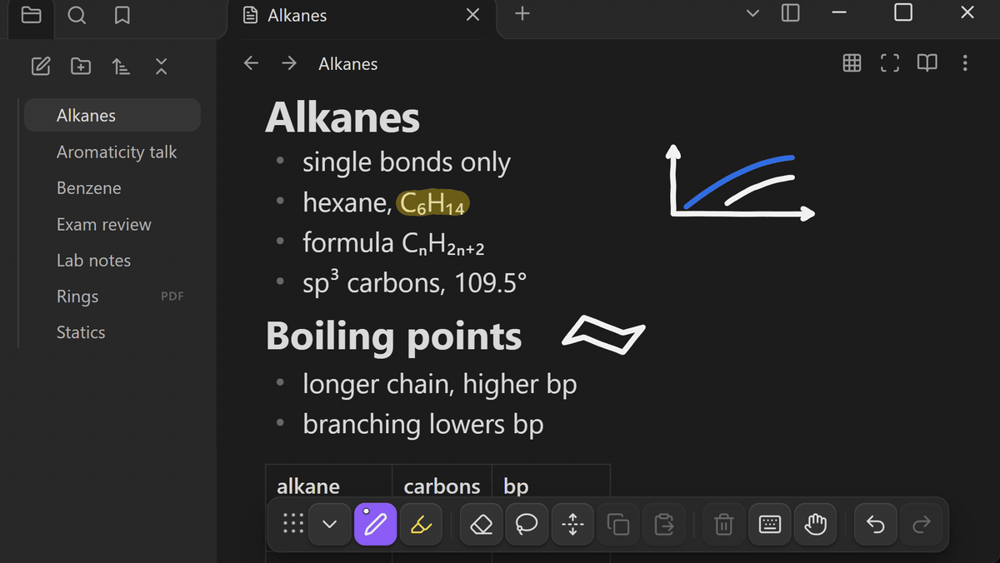

Open a note and write. The note stays a `.md` file.

## removing the plugin

your ink is not stored "in" the markdown. it lives in a folder at your vault root, separate from the editor's text.

disable the plugin and your notes STAY EXACTLY THE SAME - the ink just stops rendering. re-enable and it comes back.

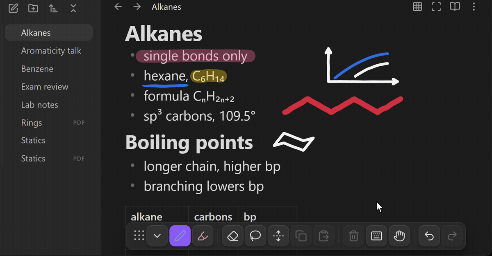

one line is written to the invisible frontmatter of a note when you first write on it - `handwriting-page-id`.

a note you never inked on is never modified.

## what it does

Here's a demonstration of some of the features: https://youtu.be/uWcOWixkxEk

### right now you can

* handwrite, highlight, color palette, size sliders
* erase, two modes, size slider
* lasso, compatible with side button; move the selection, delete it, copy/paste it across notes (resize and rotate coming soon)
* insert space tool
* undo/redo ink + text
* draw + pan with the mouse if you want
* pdfs: annotate, export, snip

### features

* data yours forever
   * your ink is all stored here: your vault's `.handwriting/` folder
   * [what that folder looks like](#where-is-ink-stored)
* pressure sensitivity
* palm rejection
* pen toolbar with auto-hide
* pinch to zoom (pdfs always; notes with **Infinite canvas** on)
* ink prediction + smoothing
* lined, grid, and dotted paper background
* export ink as svg or pdf
* true infinite canvas
* ink works in embeds
* handwriting to shape snap
* works on slides

### works on

windows · macos · linux · ipad · boox · android

### doesn't really work on

iphone

---

### ipad notes

> turn off Scribble or ios will draw its own black ink over your strokes, and its scratch-out gesture may delete ink.
>
> **iPad Settings → Apple Pencil → Scribble → Off**

---

## installing

### method 1 - the community plugin directory

it's in the community plugin directory:

1) Settings
2) Community plugins
3) Browse
4) search Handwriting
5) Install and enable

### method 2 - direct link

can also just get it here:

https://community.obsidian.md/plugins/handwriting

## using it

### settings

**most of Handwriting's options live in Settings > Handwriting.** 

### toolbar

the toolbar sits top right by default. you can drag and drop the toolbar. you can also collapse it by tapping the arrow. there are nine spots to choose from. location and visibility can also be changed in Handwriting settings.

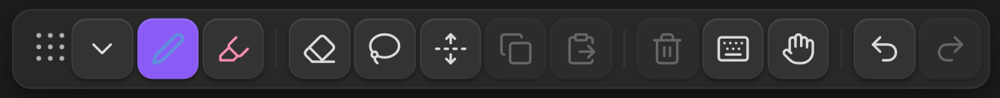

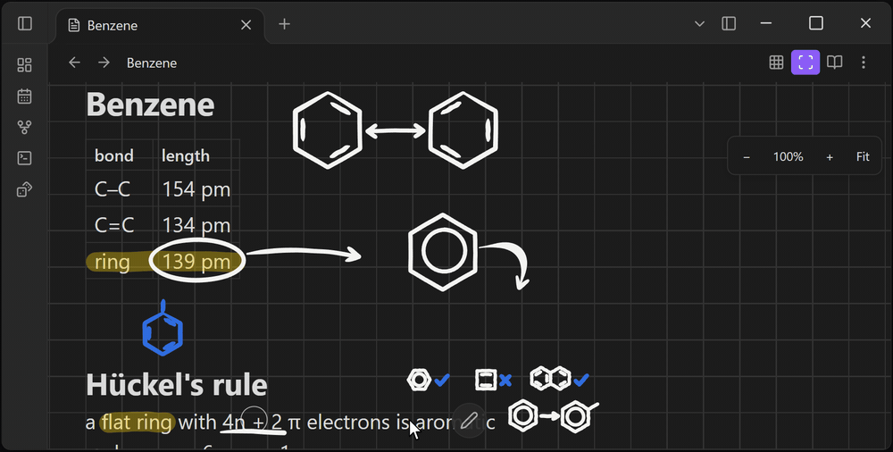

### escape

`Esc` closes most controls, then drops you back to the text in most cases.

### tools

tap a tool and use it: pen, highlighter, eraser, lasso, insert space, or pan. tap More if buttons are hidden.

tap the pen, highlighter, or eraser again while it is selected to open its controls.

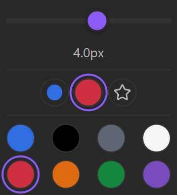

### keyboard button

the keyboard button disables pen input so a tap can place the caret and open the on-screen keyboard. this may be useful for viewing pdfs. tap it again to get the pen back. `Handwriting: Pen on / off` does the same from the command palette.

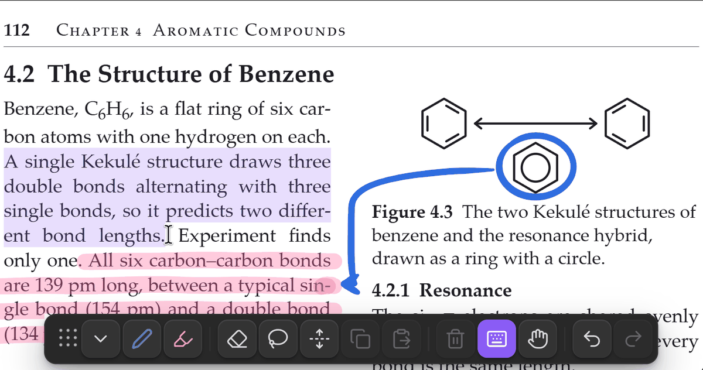

### pen side button

you can change what the side button does. this is useful for android and S pen users but others might find it useful. android users will get a "click while hovering to toggle eraser" function while everybody else get "hold to erase OneNote style" when changing this setting. this is due to a quirk in android

### paper and infinite canvas

you can turn infinite canvas or paper backgrounds on/off individually per-note with the buttons in the top right:

you can also change it via the three dot menu in the top right. But the buttons are easier. there is no difference between the two ways, frontend speaking

you may also find the global option in the Handwriting settings menu. `Handwriting: Paper: none / lines / grid / dots` in the command palette cycles through the paper backgrounds.

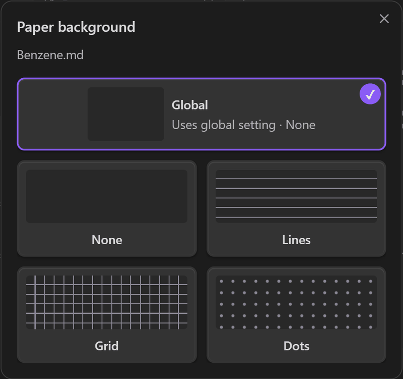

with infinite canvas on you can zoom out and keep writing past the edge of the note. `Fit` zooms so all of your ink fits on screen.

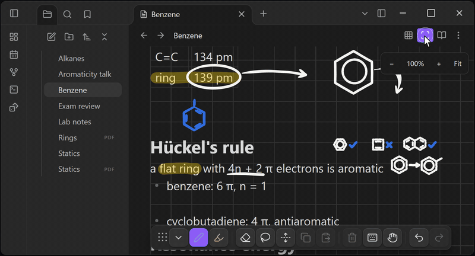

### mouse input

to write with your mouse, run `Handwriting: Mouse on / off`.

### extra commands for hotkeys

enable Extra commands for hotkeys in Handwriting settings (near bottom of page) to add these commands to the command palette:

* `Handwriting: Ink color: next`
* `Handwriting: Pen color: next`
* `Handwriting: Highlighter color: next`
* `Handwriting: Ink size: next`
* toggles for eraser, lasso, insert space and pan
* `Handwriting: Pen preset 1` through `4`
* `Handwriting: Highlighter preset 1` through `4`
* a save command for each preset slot

this is useful because each command can be assigned its own hotkey. for power users.

the commands are hidden by default because their sheer number makes other Handwriting commands harder to find. disabling the setting removes them from the palette but will preserve hotkey assignments.

### shape snap

hold the pen still for about a third of a second at the end of a stroke to snap it into a line, triangle, rectangle, circle or ellipse.

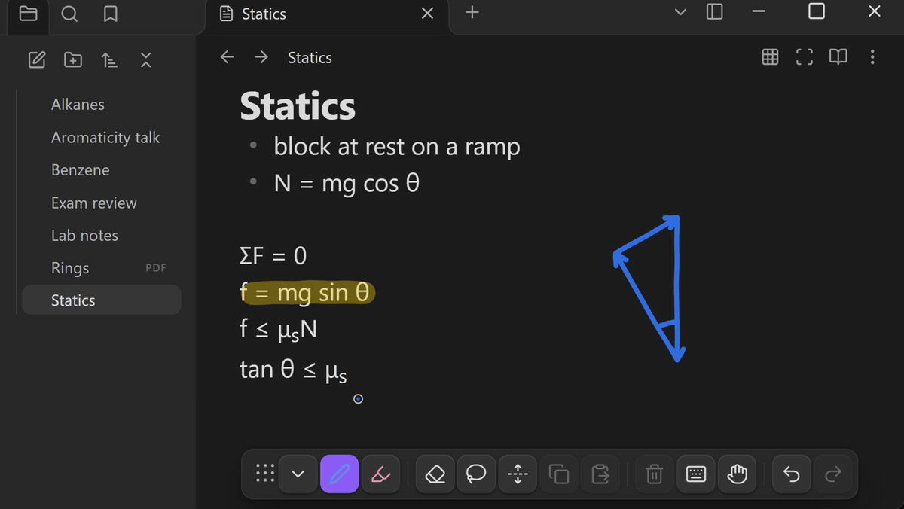

with a mouse, pause at the end of a stroke and select Snap.

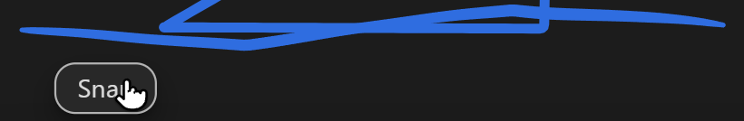

### lasso and snip

you can lasso ink to move or copy and paste it anywhere in the note, or across different notes. You can also use `Handwriting: Snip the selection to an image` to save what you lassoed as a png next to the file and copy a link to it to your clipboard, so you can paste it into a note.

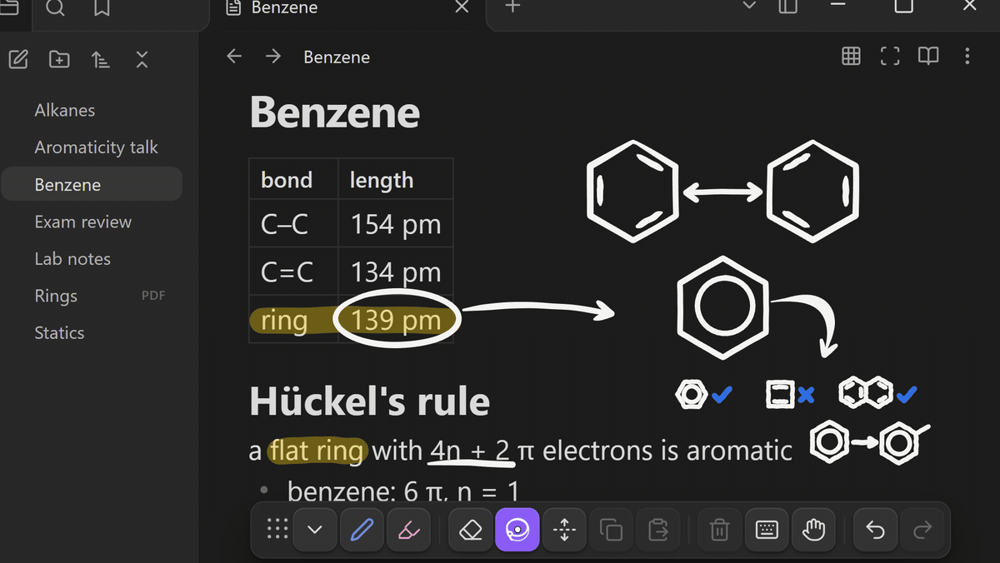

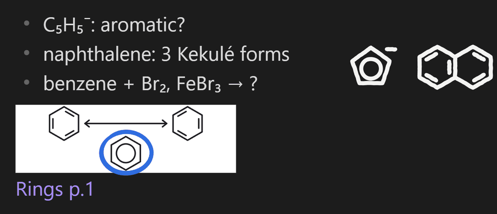

### insert space

tap insert space, press on a line and drag down. everything below the line follows your pen, so you get room to write.

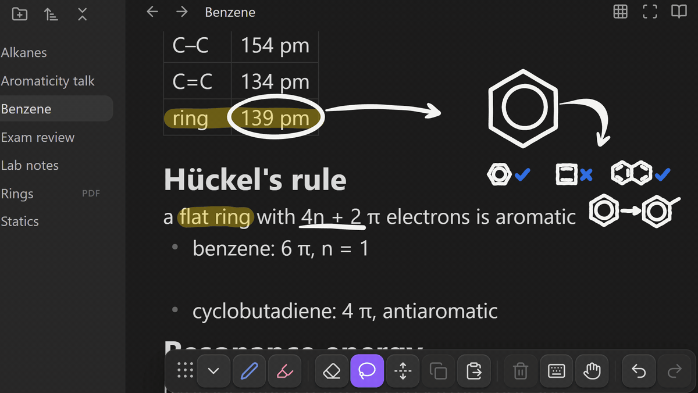

### boox and e-ink users

if you're having latency issues on a Boox device, try turning on Boox mode in Handwriting's settings near the bottom of the menu. it might help a little.

every redraw costs on e-ink, so it turns off smoothing, the pen reticle and animations, and sizes prediction for e-ink delay. your old settings come back when you turn it off.

### pdfs and exporting

you can annotate pdfs. same toolbar. same tools

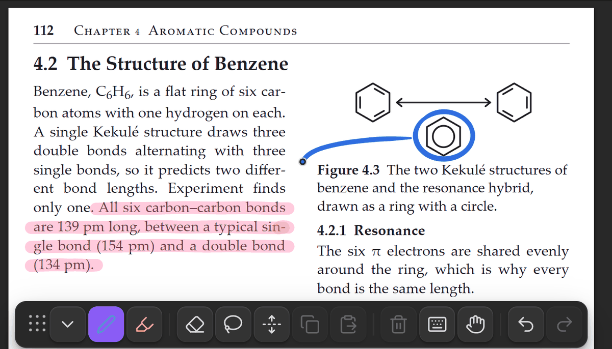

* `Handwriting: Export ink as SVG (drawing only)` and `Handwriting: Export ink as PDF (drawing only)` export the drawing by itself, cropped to the ink, with no background
* `Handwriting: Flatten ink into a copy of this PDF` draws the ink into a copy of the pdf so anyone can open it

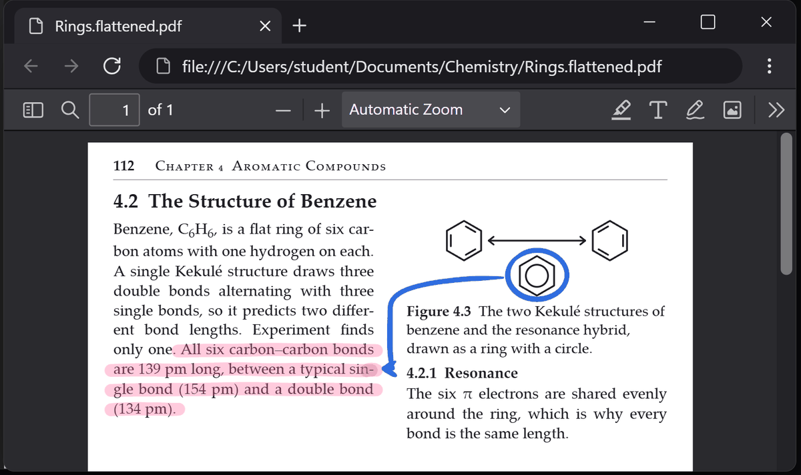

you can also use the native Obsidian Export to PDF command. the page is shrunk to fit the paper export, so your ink should stay on its words. warning: text can come out a little smaller than a plain export.

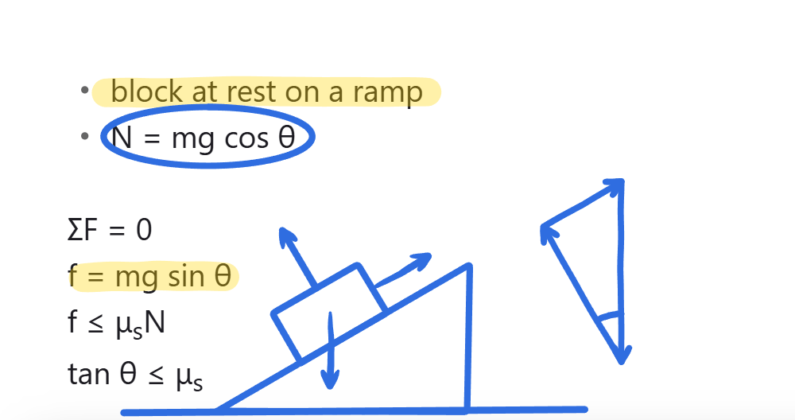

### ink works on slides too

`Handwriting: Toggle slides ink` turns it on while you present.

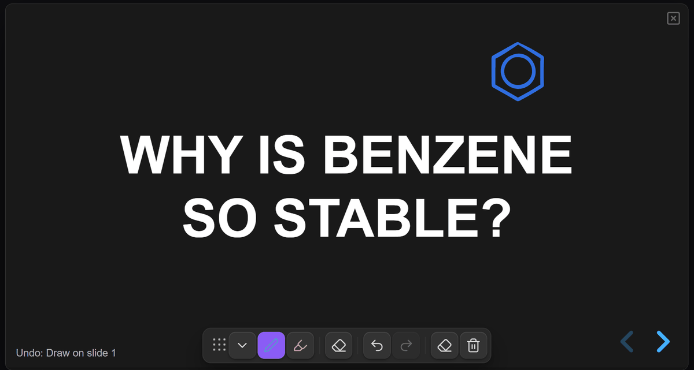

* `Handwriting: Presentation: undo ink` and `Presentation: redo ink`
* `Handwriting: Clear ink on this slide`
* `Handwriting: Clear all presentation ink`

### ink color

two settings in Settings > Handwriting decide how ink looks against the background.

* **Ink color on PDFs** darkens or lightens your ink, or leaves it alone. default is darken.
* **Ink color when exporting** keeps pen ink readable in exports, prints and snips. default is automatic.

### resetting a note

`Handwriting: Delete all ink on this note` and `Handwriting: Delete all ink on this PDF` are in the command palette. running these commands will still save a copy of your ink and also you can undo the action with ctrl+z

---

### obsidian sync notes

> `.handwriting/` is a hidden folder. many sync services do not sync hidden folders by default, including Obsidian Sync, iCloud and Dropbox.
>
> if you use one of these services, enable **Compatibility with Obsidian Sync, iCloud and Dropbox** in Handwriting settings.
>
> Obsidian Sync also needs **Sync all other types** turned on (Settings, Sync, selective sync). ink is saved as `.json` files, and Obsidian Sync skips those by default.

---

## how it works

this is a section dedicated to anyone curious about the mechanisms

to sum up: Obsidian's live editor handles the Markdown. transparent canvas layer above it draws the ink. then logic layer decides whether or not the thing poking it is a pen, a finger, or a palm

### where is ink stored

your ink is one json file per note in /.handwriting/

(your vault)/.handwriting/

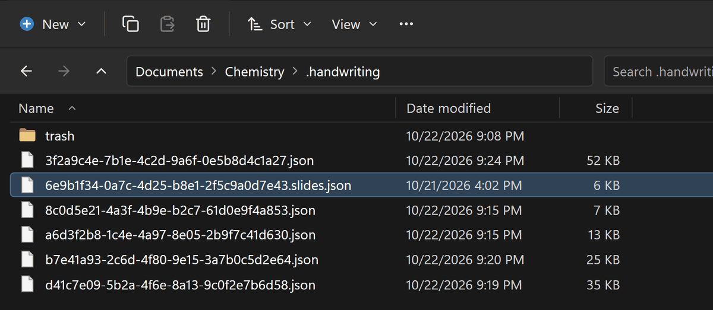

sidecar is a digital photography term that refers to a small file besides a main file, that holds information about the main file. this is a useful analogy

in this case, the sidecar stores your ink as coordinates - your note is linked to your ink by a single properties line in the properties field of your note. this link + the coordinates tells Obsidian where all the ink is

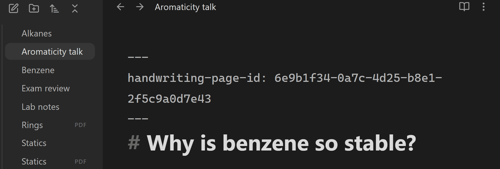

what this means practically is that no matter what happens to the ink, the text in your note will be safe, as the note itself is not modified (besides its frontmatter).

### why the ink looks good

a typical pen reports ~200-250 dots/events a second. what other handwriting apps probably do (almost certainly) is draw straight lines between each dot - this is what causes the jaggedness or spikiness on boox or other e-ink devices, also because the pen trembles a bit naturally

what i did is smooth the curve by adding the previous dot into the calculation. this causes bad perceived lag, so i had to replace the last stretch of the curve to the pen tip with a straight line in real time

### how does it stay still

ink coordinates are stored in the sidecar. origin is at the top-left of the text column, absolute y down the document.

any transformation of the viewport, Handwriting calculates where that part of the note is on your screen and redraws the ink. then, Handwriting matches the overlay to the live editor pane.

this sounds pretty straightforward. 

however if you resize Obsidian, resize a window pane, change the font size, pinch the screen, zoom with ctrl+, ctrl-, or ctrl & scroll, use a theme that moves the text column, use a theme that moves the live editor, change the readable line length setting, or simply pan, the coordinates must transform to match

### undo/redo

if you draw, type, then erase, ctrl+z should undo those things in the order you did them

this meant Obsidian, not just Handwriting, needed to know what an ink action is and in what order

each ink action had to be translated to be able to be recorded in obsidian's undo history. adding a stroke. moving a lasso selection. which strokes moved and by how much. erasing. what was removed and how much of it

teaching these operations to participate in the editor's history alongside text gives seamless undo/redo for text and ink

if you have any questions i will try to answer as best i can

## reporting problems

[open an issue](https://github.com/ellimist-afk/handwriting/issues/new/choose). report what happened. remember to include which device and pen please.

EZ-MODE reporting:

run `Handwriting: Bug report: record`.

reproduce the bug.

run `Handwriting: Bug report: send`.

press `Upload` on that window and the report comes straight to me 🙂 paste the id it gives you into your issue or the reddit thread so I know where it came from.

for those of you nervous about sending bug reports: the report holds pen strokes (coordinates and timings) and a few other non-identifying info like cursor offset and the scroll position. it never holds your note's text. 

and i guarantee nothing will leave your device unless you press `Upload` button. still uncomfortable with telemetry? `Copy` and `Save to Vault` buttons are offline ways to do bug reports

## coming soon

* audio alongside ink
* ruler + compass on screen
* laser pointer
* ocr / handwriting to text ( very soon )
* searchable handwriting ( very soon )
* handwriting to math/latex ( very soon )
* text boxes (soon)
* compatibility with Obsidian's canvas mode
* more custom colors

## money

Handwriting is free. i still work on it almost every night. if you want to buy me a coffee:
https://ko-fi.com/ellimistafk

thank you for using my plugin.

## license

CC BY-NC-ND 4.0

## why i built this

back in uni i remember taking biochem notes on a Surface Pro 4. drawing structures and typing labels on the same OneNote page felt like literal magic. it has been more than 10 years since those halcyon days. i'm driven to try and recreate that same magic again, but in Obsidian. i hope you find my plugin useful.

Handwriting is designed for students, educators, engineers, artists, or anyone who needs to handwrite and type in Obsidian.
